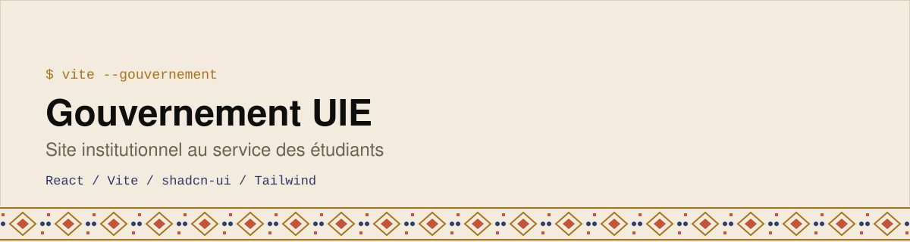

<div align="center">
  <picture>
    <source media="(prefers-color-scheme: dark)" srcset="assets/banner-dark.svg">
    
  </picture>
</div>

Interface web institutionnelle du **Gouvernement UIE**, pensée pour les étudiants : présentation du gouvernement, activités, programme et services.

    

## Pages
| Route | Contenu |
|---|---|
| `/` | Accueil |
| `/gouvernement` | Présentation du gouvernement |
| `/activites` · `/programme` | Activités et programme |
| `/participer` | Participer à la vie du gouvernement |
| `/services` | Services, avec **Moov**, **Telimani** et **restauration** |

## Fonctionnalités techniques
- Recherche globale dans le site (index de recherche côté client)
- Hook de notifications
- Composants shadcn/ui (Radix) et design responsive
- Tests avec Vitest

## Lancer le projet
```bash
npm install
npm run dev
```
Une configuration Netlify est incluse pour le déploiement.

## Licence

Code sous [licence MIT](./LICENSE) · © 2026 Emmanuel Elisé Koné.
Le nom, les logos et l’identité visuelle de **l’UIE et du Gouvernement UIE** ne sont pas couverts par cette licence.

---

Construit par **Emmanuel Elisé Koné** ([BinaryMaoGenius](https://github.com/BinaryMaoGenius)) · *La tech en clair*
